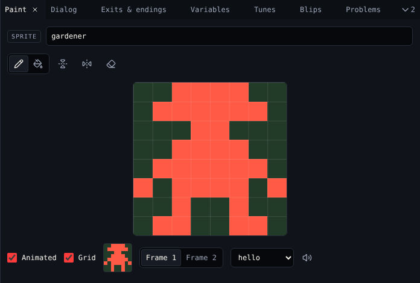

# Paint

**Paint** draws the tile, sprite or item you picked in [Library](library.md) or with **Pick** in [Room](room.md). Every drawing is 8×8 pixels.

{ .shot }

## Draw

| Control | Key | Does |
|---|---|---|
| **Pencil** | ++b++ | Click a pixel to turn it on, or off if it is on. Drag to keep going. |
| **Fill** | ++f++ | Fills the area you click |
| **Flip left to right** | | Mirrors the frame |
| **Flip upside down** | | Turns the frame over |
| **Clear** | | Empties the frame |
| **Grid** | | Shows pixel lines |
| Name | | The drawing's name, used in every menu |

A drawing has two colours: on and off. The colours come from the room's palette: tiles use the **Tiles** colour, sprites and items the **Sprites and items** colour, and off is the **Background**. See [Colors](colors.md).

## Animate

Tick **Animated** to give the drawing a second frame. Choose **Frame 1** or **Frame 2** to draw each. The small preview shows how it moves in the game, swapping frames about every 400 ms. Untick **Animated** to go back to one frame.

## Tiles: walls

Tick **Wall** on a tile to stop the avatar walking through it. **Walls** in Room shows which tiles are walls.

## Sprites and items: sound

**Sound** picks the [blip](blips.md) the sprite or item plays when the avatar meets it. The speaker button plays it.

What a sprite or item says is in [Dialog](dialog.md).

## Related

- [2. Avatar and sprites](../tutorial/2-avatar-and-sprites.md) in the tutorial
- [Library](library.md) to add, copy and delete drawings
