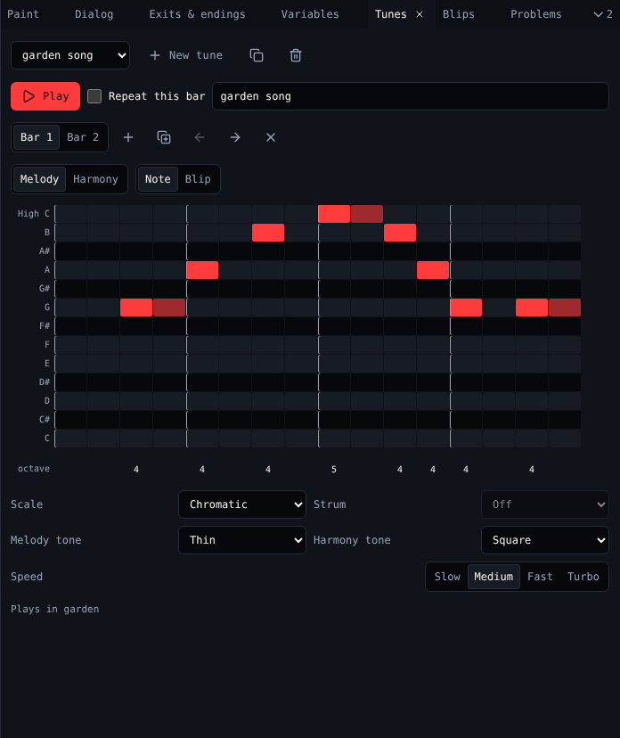

# Tunes

A **tune** is music a room plays while the avatar is in it. **Tunes** writes it on a staff, one bar at a time, with two parts: a **melody** and a **harmony**.

{ .shot }

## Tunes

| Control | Does |
|---|---|
| Tune menu | Picks a tune |
| **New tune** | Adds an empty tune |
| **Copy tune** | Copies it |
| **Delete tune** | Deletes it after asking. Rooms that played it go quiet. |
| **Play** | Plays the tune, with a line showing the beat. Press again to stop. |
| **Repeat this bar** | Plays only this bar, over and over |
| Name | The tune's name in menus |

A tune does nothing until a room plays it: pick it in **Music** in [Room](room.md). The bottom of Tunes says which rooms play it.

## Bars

A bar is 16 beats. **Bar 1**, **Bar 2** and so on pick a bar.

| Button | Does |
|---|---|
| **Add bar** (+) | Adds an empty bar at the end |
| **Copy bar to the end** | Copies this bar after the last one |
| **Move bar left**, **Move bar right** | Moves this bar |
| **Remove bar** (×) | Removes this bar |

## Write notes

1. Choose the part: **Melody** or **Harmony**.
2. Click a cell on the staff: the row is the note, the column the beat. You hear the note.
3. Drag right to make the note longer. Click a note to take it away.
4. Click the **octave** number under a note to move it up an octave.

**Pen: Blip** puts a [blip](blips.md) on the beat instead of a note: pick which one next to it.

## Sound

| Control | Choices |
|---|---|
| **Scale** | Major (five cheerful notes), Minor (five gloomy notes), Full major, Full minor, Chromatic (every note). The staff shows only the scale's notes. |
| **Strum** | Off, Chord up, Chord down, Small interval, Big interval. With a strum, the harmony plays a chord from one note per bar. Needs a scale. |
| **Melody tone**, **Harmony tone** | Square, Thin or Thinner |
| **Speed** | Slow, Medium, Fast, Turbo |

## Related

- [Blips](blips.md)
- Dialog's **Play a tune** (`{tune "1"}`) changes the music while the game runs
