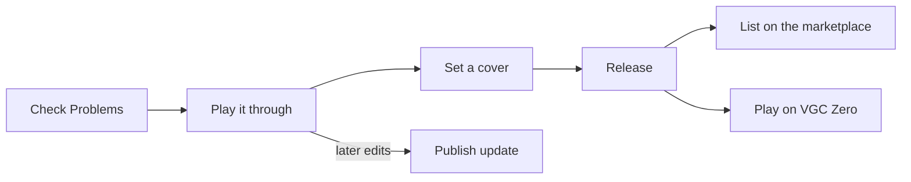
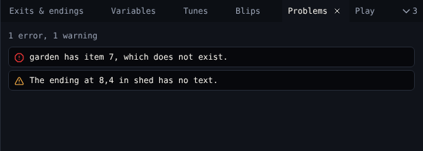
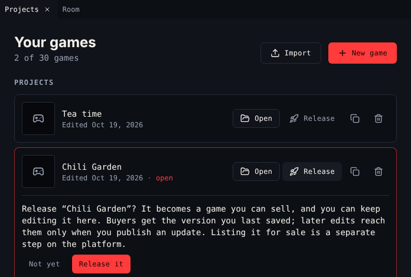

# 7. Test and release

Your game is done. In this last step you check it, play it from start to end, release it so people can buy or download it, and play it on the handheld.

## Check for problems

Open [Problems](../tools/problems.md). It lists anything that would stop the game working as you meant: a missing palette, an exit off the room, an ending with no text. Click a problem to jump to it. The footer shows the count all the time, and says **No problems** when there are none.

{ .shot }

## Play it through

Open [Play](../tools/play.md) and choose **Play game**. It runs **citsy**, the same engine that runs on VGC Zero, so what you see is what the handheld shows.

{ .shot }

| Action | Keyboard | Phone | VGC Zero |
|---|---|---|---|
| Walk | Arrow keys or ++w++ ++a++ ++s++ ++d++ | On-screen arrows | D-pad |
| Talk, next page | ++space++, ++enter++, ++z++ or ++x++ | **Ok** | **A** |

- Walk into every sprite, pick up every item, go through every exit and reach every ending.
- Watch **Inventory** and **Variables** under the screen.
- **Restart** starts again from the title.

## Make a cover and a GIF

While the game plays:

- **Use as cover** shows the current frame with your game on the platform.
- **Save picture** downloads the frame as a PNG.
- **Record GIF** records up to 30 seconds. **Stop recording** downloads the GIF.

## Keep a copy

[Download](../tools/download.md) gives you the `.bitsy` file, or one web page that plays the game anywhere, for example on itch.io.

## Release it

A project cannot be sold. Releasing makes it a game.

1. Open [Projects](../tools/projects.md) and choose **Release** on Chili Garden.
2. Read the note and choose **Release it**.

{ .shot }

The game moves to **Released**, and to the **My games** shelf of your [Library](https://platform.chilichip.eu/library) on the platform. It is not for sale yet.

## List it on the marketplace

On the platform, open the **My games** shelf of your [Library](https://platform.chilichip.eu/library) and choose **List a game on the marketplace**. Set a price, free or more, and publish it. Prices, fees and payouts are in [List a game for sale](https://platform.chilichip.eu/help/sell-a-game).

## Update a released game

You can keep editing a released game. Players keep the version you released until you choose **Publish update** on it in Projects. The top bar shows **unpublished changes** until you do. Each update gets the next release number.

## Play it on VGC Zero

Copy the `.bitsy` file into the `bitsy-games` folder on the console's **CHILICHIP** drive. It shows up on the home screen. See [Play on VGC Zero](../reference/vgc-zero.md).

## Share it

Show it in the [forum](https://platform.chilichip.eu/community) or on [Discord](https://discord.gg/xB9sPYKBZc). We love seeing what people make.

You finished the tutorial. The [tools](../tools/index.md) pages cover everything the tutorial skipped.
