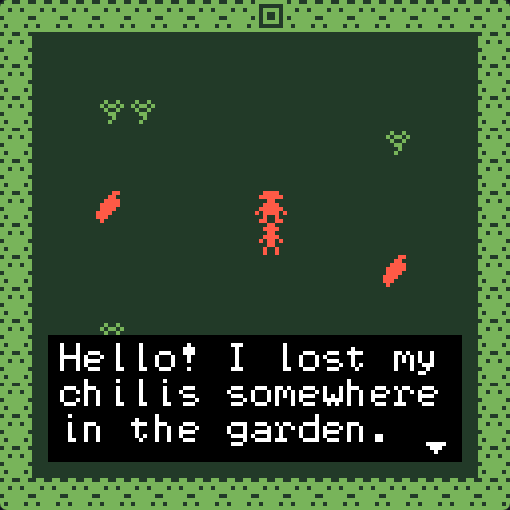
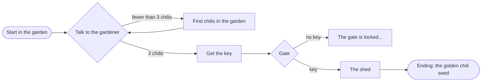

# Tutorial: Chili Garden

In seven short steps you build **Chili Garden**: a gardener has lost three chilis. Find them, get the key to the shed, and open the gate to find what is inside.

{ .pixel }

Each step starts where the last one ended and takes about 10 minutes. Read them in order the first time.

| Step | You learn | Tools |
|---|---|---|
| [1. Rooms](1-rooms.md) | Start a game, choose colours, draw tiles and walls | Projects, Colors, Library, Paint, Room |
| [2. Avatar and sprites](2-avatar-and-sprites.md) | Draw the avatar and a character, animate it, give it a sound | Paint, Library, Room |
| [3. Items](3-items.md) | Draw items and scatter them for the player to find | Library, Paint, Room |
| [4. Dialog](4-dialog.md) | Make the gardener talk, and answer differently once you have the chilis | Dialog |
| [5. Exits and endings](5-exits-and-endings.md) | Add a second room, a locked gate and an ending | Room, Exits & endings, Colors |
| [6. Variables](6-variables.md) | Remember that the gardener said thank you | Variables, Dialog |
| [7. Test and release](7-test-and-release.md) | Play it through, fix problems, release it and play it on VGC Zero | Problems, Play, Download, Projects |

## The game you will make

## Download the finished game

Stuck, or want to look ahead? Download [chili-garden.bitsy](../assets/tutorial/chili-garden.bitsy) and open it with **Import** in [Projects](../tools/projects.md). It is the game every screenshot in these docs shows.

!!! tip "Before you start"
    You need a Chili Platform account with a verified email. See [Open the creator](../get-started/open-the-creator.md).
